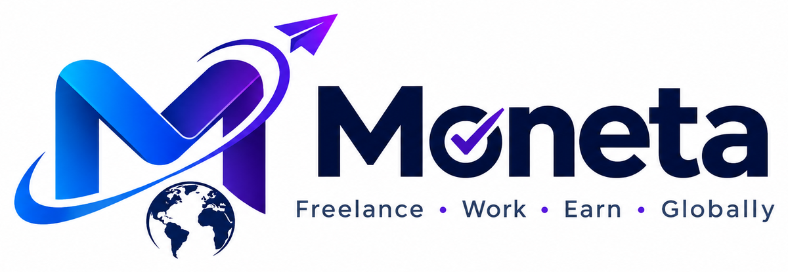

<p align="center"></p>

# Moneta: Daily Expense & Budget Tracker

Moneta is a mobile-first, offline-ready (PWA) expense, budget and savings tracker.
It works with **any currency** and **any language**, and every part of it can be
customised from inside the app.

- **Stack:** React 18, TypeScript, Vite, Tailwind CSS, Dexie (IndexedDB), Recharts, i18next, and optional Supabase sync
- **Languages included:** English, বাংলা, Deutsch (DE/AT), Norsk bokmål, हिन्दी. Users can add more (including RTL languages such as Arabic or Urdu) or edit any text in **Settings → Language editor**.
- **Plan & data schema:** see [PLAN.md](PLAN.md)

## Run locally

```bash
npm install
npm run dev          # http://localhost:5173
npm run build        # type-check and production build to dist/
npm run preview      # serve the production build (http://localhost:4173)
```

The first launch opens a setup wizard (language → country → main currency → categories).
Turn on **Load demo data** to explore the app with 3 months of sample entries. **Settings → Data → Remove demo data** deletes only the sample entries later (your own entries stay).

## Features

| Area | What's included |
|------|-----------------|
| Entry | FAB → bottom sheet with custom numpad (supports `+ − × ÷`), expense/income/transfer, per-entry currency, category + subcategory tiles, account chips, date/time, note, #tags, receipt photo, repeat, save as template, edit/delete with **Undo**, keyboard support on desktop |
| Currency | All ISO 4217 currencies; editable symbol, position, decimals and spacing per currency; decimal/group separators; western / **Indian lakh-crore** / no grouping; digit styles 123 / ১২৩ / ١٢٣ / १२३; live rates (open.er-api.com) with manual override and offline fallback; cross-currency transfers |
| Localisation | Language switch at any time, RTL support, date format, first day of week, month start day (salary day) |
| Categories | Defaults + presets (Standard, Student, Family, South Asia, Freelancer); add/rename/delete/reorder; subcategories; icon & colour |
| Accounts | Unlimited; cash/bank/card/wallet/other; any name (bKash, PayPal…); own currency, icon, colour; archive; net worth in main currency |
| Budgets | Daily/weekly/monthly/yearly, overall or per category; green/yellow/red with icon + label; alert threshold; rollover; "You can spend X/day" |
| Goals | Unlimited; deposit/withdraw; progress ring; ETA; per-day amount needed; confetti at 25/50/75/100 % |
| Dashboard | Net worth, today/week/month, alerts, trip, budgets, category donut, 14-day bars, income vs expense line, top 5, vs last month + insights, goals, health score, recent. Widgets can be shown/hidden and reordered |
| Reports | Day/week/month/year/custom with prev/next; calendar heat-map; search + filters (category, account, currency, amount, date, tag, note); export **PDF / Excel / CSV**; JSON backup & restore |
| Extras | Debts/loans with payments & due reminders; split bills (equal/custom → creates debts); bill reminders with "Paid" (creates the expense); recurring entries; templates; dark/light/auto theme + accent colour; PIN + biometric lock; daily reminder; monthly health score; Trip/Event mode |

## Brand

Moneta is designed and developed by **MD. Towfiq Bin Hasan** with **TH Team**. The TH Team logo appears next to the Moneta logo on the loading splash, the sign-in screen, Settings → About and the More page (`MadeBy`, `CoBrand` and `TeamLogo` in `src/components/Brand.tsx`).

All brand assets are generated from the original logo and banner files in `public/brand/`.

| File | Use |
|------|-----|
| `brand/th-badge-{128,256}.webp/png` | TH Team logo, round badge (any theme) |
| `brand/th-glow-256.webp/png` | TH Team logo with the black made transparent (splash and dark panels) |
| `brand/moneta-mark-{128,256,512}.webp/png` | Logo mark (transparent): sidebar, splash, lock, auth, 404, PDF export |
| `brand/moneta-banner-light.webp` / `-dark.webp` | Banner for light and dark themes (the dark version has white text). It switches automatically. |
| `brand/moneta-banner.png`, `og-image.jpg` | Original-style banner for the README and social sharing (Open Graph) |
| `icon-192/512.png`, `icon-maskable-512.png`, `apple-touch-icon.png`, `favicon-*.png` | PWA, home-screen and browser icons |
| `brand/*-original.png` | Untouched source files (not precached) |

The brand palette comes from the logo: cyan `#00b8ff` → blue `#2563ff` → violet `#8b2cf5` on navy `#0b1240`.
- The default accent is the logo blue. The two companion colours (`--brand-2`, `--brand-3`) are derived by shifting the hue of whatever accent you choose, so the gradient keeps the logo's look.
- The wordmark is in Plus Jakarta Sans ExtraBold, with the check mark drawn in place of the "o".

Logo animations (`src/components/Brand.tsx`):
- **Splash:** an orbit draws itself around the mark while a comet travels along it, the letters rise one at a time, and the tagline fades in.
- **Everywhere:** the mark has a breathing glow and a light sheen that sweeps across only the logo's own shape. On hover it tilts slightly.

## Accounts & cloud sync (Supabase)

- **Sign-in:** email/password, Google, password reset, and "Continue without an account".
- **Desktop sign-in page:** a split-screen layout with the animated brand panel.
- **Sync:** changes upload a few seconds after you make them, on focus or reconnect, and every minute. Changes from your other devices arrive instantly through **Realtime**.
- **New device:** signing in on a new device downloads your settings and data, and setup is skipped.
- **Different account:** if someone signs into another account on a device that already has data, Moneta asks before mixing anything.
- **Sign out:** you choose whether to keep this device's data (it keeps working offline) or remove it (for a shared computer).
- **Status:** the live sync status shows in the top bar, the avatar menu, the sidebar, and Settings.

## Desktop features

- A sidebar with grouped sections. It collapses to an icon-only rail (`[`), with tooltips.
- A top bar with search, live sync status, import, a theme toggle, and the account menu.
- **Command palette** (`Ctrl/⌘ K` or `/`): run actions, jump to any page, and search transactions, categories and accounts.
- **Keyboard shortcuts** (`?` shows the list):
  - `N` / `I` / `T` add an expense, income or transfer.
  - `G` followed by `H`/`T`/`R`/`B`/`G`/`A`/`C`/`D`/`S` jumps to a page.
  - `D` toggles dark mode and `S` switches style.
- **Transactions table:**
  - Sortable columns, plus multi-select (checkbox, Shift-click for a range, `Ctrl/⌘ A` for all).
  - A floating bulk bar to change category, move to another account, export CSV, or delete (with Undo).
  - Right-click menu, and `Delete` / `Esc` keys.
- **Drag & drop anywhere:** a CSV opens the import, a `.json` backup restores, and an image becomes a receipt on a new expense.
- **CSV import:**
  - Detects the delimiter and columns automatically (including Moneta's own export in any language), and you can remap every column.
  - Shows a preview, can create missing categories, and imports in one batch with a single Undo.
- The dashboard uses up to 3 columns on very wide screens.

## Design system & motion

**Six themes**: three surface styles × light/dark, chosen in Settings → Appearance (with live previews), in the setup wizard, or with the palette button on the dashboard.

| Style | Look | Font |
|-------|------|------|
| **Receipt** (default) | Thermal receipt: paper tones and grain, dashed rules, a torn zig-zag edge on the balance card, subtle aurora | IBM Plex Mono |
| **Glass** | Frosted translucent cards and bars floating over a slowly drifting aurora | Plus Jakarta Sans (tabular figures on) |
| **Brutal** | Neo-brutalist: 2.5px ink borders, hard offset shadows, dot-grid paper, buttons that physically press in | Space Mono |

How it works:
- The theme is an attribute: `<html data-theme="{style}-{light|dark}">`. It is not React state.
- **No flash on load:** a blocking script in `index.html` applies the saved theme before first paint. It reads a localStorage mirror of the setting.
- **Sync:** the theme follows the OS colour scheme when set to "Auto", and changes made in one tab appear in your other open tabs.
- **Smooth switching:** theme changes cross-fade via the View Transitions API where supported.
- **Where the mappings live:** `src/theme/theme.ts` owns the style × mode mapping, and `src/theme/accents.ts` provides named card hues (`accent('emerald').grad / glow / text / dot / soft / line`).
- **One place for colours:** all colours are tokens in `src/index.css`. Components use semantic classes (`.m-card`, `.m-btn`, `.m-input`, `.m-tile`, `.m-sheet`, `.m-bar`, `.m-label`) that each style restyles, so components need no theme conditionals.

**Motion & feel:**
- **Navigation:** pages rise in on route change, and dashboard widgets enter with a stagger.
- **Numbers:** balances and the health score count up. Progress bars and rings fill on mount, and an exceeded budget shimmers.
- **Sheets:** they spring up, can be dragged down to dismiss (by distance or flick velocity), and animate out.
- **Swipe gestures on entries:** swipe ← to delete (with Undo), swipe → to duplicate.
- **Quick add:** digits pop as you type, and an invalid save shakes. On supported phones there's a short vibration on taps, saves and errors.
- **Controls:** segmented controls have a sliding pill, the bottom nav has an animated active pill, and the FAB rotates to × while the add sheet is open.
- **Toasts** have a self-drawing check mark and an Undo countdown bar.
- **Reduced motion:** all of the above is disabled when the OS asks for reduced motion.

**Personal touches:** profile name and avatar (shown in the greeting and the side bar), and cover pictures for savings goals. Pictures are checked before use (JPG/PNG/WEBP/GIF/HEIC, at most 8 MB), and the rule is printed under each picker. They are resized and stored on the device.

**Resilience:** each page has its own error boundary with "Try again", there is a friendly 404 page, and the splash screen is animated.

## Cloud sync (optional, Supabase)

The app is fully usable without an account. To enable login and sync across devices:

1. Create a free project at [supabase.com](https://supabase.com).
2. In **SQL Editor**, run [`supabase/schema.sql`](supabase/schema.sql). It creates the `records` table and row-level security.
3. In **Authentication → Providers**, make sure Email is enabled.
4. Copy `.env.example` to `.env` and fill in the values from **Project Settings → API**:
   ```
   VITE_SUPABASE_URL=https://xxxx.supabase.co
   VITE_SUPABASE_ANON_KEY=eyJ...
   ```
5. Under **Authentication → URL Configuration**, set the **Site URL** to your live URL (e.g. `https://moneta-th.vercel.app`). Under **Redirect URLs**, add:
   - `http://localhost:5173/**` (local development)
   - `https://moneta-th.vercel.app/**` (your Vercel domain)
   - `app.moneta.tracker://auth-callback` (the phone app's Google sign-in)
6. (Optional) For Google sign-in, enable it under **Authentication → Providers → Google** and paste the OAuth client ID and secret.
7. Restart `npm run dev`. The sign-in option now appears in the avatar menu, the setup wizard and **Settings → Cloud sync**.

Sync is last-write-wins per record. It pulls first, then pushes, and deletions are propagated.
The app lock (PIN/biometric) stays on each device and is never uploaded.

## Deploy

### Vercel
1. Push the project to GitHub.
2. Go to vercel.com → **New Project** → import the repo. Vite is auto-detected (build `npm run build`, output `dist`).
3. Under **Environment Variables**, add `VITE_SUPABASE_URL`, `VITE_SUPABASE_ANON_KEY` and `VITE_SITE_URL` (your Vercel URL).
4. Deploy. `vercel.json` already handles SPA routing, caching and security headers.
5. Put the Vercel URL into Supabase's **Site URL** and **Redirect URLs** (see above).

From the terminal instead: `npx vercel` (first time: log in and link), then `npx vercel --prod`.
Env vars are read at build time, so redeploy after changing them.

### Netlify
1. Push to GitHub, then on netlify.com go to **Add new site → Import from Git**.
2. `netlify.toml` already sets build `npm run build`, publish `dist`, and the SPA redirect.
3. (Optional) Add the two Supabase env vars in **Site settings → Environment variables**.

Once deployed over HTTPS, phones can **install** the app ("Add to Home screen"), and it then works offline.

## Mobile app (Android / iOS)

The same code runs as a real phone app through [Capacitor](https://capacitorjs.com). The native project lives in `android/`, and the config is in `capacitor.config.ts` (app id `app.moneta.tracker`).

Things that work differently in the phone app:
- **Reminders** are real OS notifications, so the daily reminder fires even when the app is closed.
- **Exports** (CSV, Excel, backup and the PDF report) open the share sheet, so you can save them to Files or Drive or send them on WhatsApp.
- **Native polish:** the Android back button closes sheets and goes back, the status bar follows the theme, and it has native haptics plus a branded icon and splash screen.
- **Google sign-in** opens the system browser and returns to the app via `app.moneta.tracker://auth-callback`.
- **App lock** is PIN only, because WebViews don't offer passkey or fingerprint login.

**Option A: Android Studio (local)**
1. Install [Android Studio](https://developer.android.com/studio). It includes the Android SDK and the right Java version.
2. Make sure `.env` contains the Supabase values and `VITE_SITE_URL`.
3. Run `npm run app:android`. It builds the web app, copies it into `android/` and opens Android Studio.
4. Press ▶ Run to start it on a connected phone (with USB debugging on) or an emulator.
5. For an installable file, use **Build → Build APK(s)**. For the Play Store, use **Build → Generate Signed App Bundle**.

**Option B: GitHub Actions (no local setup)**
1. Add these repository secrets (**Settings → Secrets and variables → Actions**):
   - `VITE_SUPABASE_URL` and `VITE_SUPABASE_ANON_KEY`: needed for sign-in in the app.
   - `VITE_SITE_URL`: your Vercel URL, used in e-mail links.
   - `ANDROID_KEYSTORE_B64` and `MONETA_KEYSTORE_PASSWORD`: the permanent signing key. Without it, each build gets a new key and Android refuses to install it over the old one.
2. Every push to `main` builds the APK and publishes it on the repo's **Releases** page as `Moneta.apk`. Open that page on the phone, download, and install.

The signing key lives only on your computer in `android/moneta.keystore`, with the password in `android/keystore.properties`; git ignores both. **Back them up somewhere safe.** If you lose them, future APKs can't update the installed app.

After changing the web code, run `npm run app:sync` to update the native app.

**iOS** (needs a Mac with Xcode):
1. Run `npx cap add ios`.
2. Run `npm run app:ios`.
3. Add the URL scheme `app.moneta.tracker` under **Info → URL Types** so the Google sign-in deep link works.

App icons and splash screens were generated from the logo. The 1024 px master icon and the Play Store icon are in `resources/`.

## Folder structure

```
src/
  App.tsx              routing, setup/lock gates, startup jobs (recurring, rates, sync, reminders)
  db/                  types.ts (schema) · db.ts (Dexie) · repo.ts (CRUD + undo + tombstones) · defaults.ts · demo.ts
  lib/                 currency · format · rates · period · stats · recurring · export · notify · lock · sync · icons · confetti
  i18n/                index.ts + locales/{en,bn,de,nb,hi}.ts
  hooks/useData.tsx    reactive store over IndexedDB + formatting helpers
  components/          ui, Sheet, Numpad, pickers, Progress, charts, Toast
  features/            setup · dashboard · transactions · accounts · categories · budgets · goals
                       reports · debts · split · bills · recurring · trips · settings · lock
supabase/schema.sql
```

## Adding a language

- **In the app (no code):** go to Settings → Language editor → New language. Choose the code, name, and whether it's RTL, and pick an existing language to start from. Translate strings inline, then Export/Import JSON to share them.
- **In code:** copy `src/i18n/locales/en.ts` to e.g. `ar.ts`, translate it, and register it in `src/i18n/index.ts` (`BUILTIN` with `dir: 'rtl'`, plus `BUILTIN_STRINGS`). Add a date-fns locale in `src/lib/format.ts` for translated month names.

## Known limits

- Browsers can't wake a closed web app without a push server, so on the web the daily reminder fires only while the app or installed PWA is running. The Android/iOS app uses real scheduled notifications. Bill and debt reminders always appear on the dashboard.
- The biometric/PIN lock is a privacy gate, not encryption of the data on the device.
- PDF export uses the browser's print dialog ("Save as PDF") so every script renders correctly.
- If a currency has no rate yet (offline on first use), conversion falls back to 1:1. Set a manual rate in Settings → Exchange rates.

## Future improvements

1. Web Push (via a Supabase Edge Function) so reminders arrive even when the app is closed
2. Receipt OCR to read the amount and date from a photo automatically
3. SMS/email parsing for bank and bKash/Paytm notifications (Android companion app)
4. Bank CSV/OFX import with auto-categorisation rules
5. Shared budgets and family accounts (multi-user sync with roles)
6. End-to-end encryption of synced data, plus an encrypted local database option
7. Historical exchange rates (convert at the transaction date instead of today)
8. Investment, asset and loan amortisation tracking
9. Home-screen widgets and Apple/Google Wallet shortcuts via Capacitor native builds
10. Voice entry ("spent 200 taka on lunch") and AI spending coach
11. More built-in languages (Arabic, Urdu, Spanish, French, Indonesian…) and Hijri/Bangla calendar display
12. Unit and end-to-end tests (Vitest + Playwright) and CI
